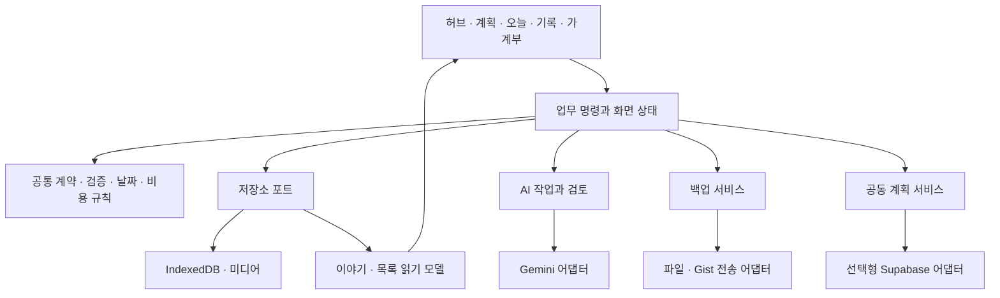

# 술술트래블 구조 검토와 개선 순서

검토일: 2026-10-09 · 기준: v1.9.2, `ac317b01d1694eaefb3d2d38568b8980b0e3b4cf`.

## 판단

현재는 기능이 부족해서보다 **같은 기능이 서로 다른 상태·검증·저장 규칙을 사용하는 문제**가 더 크다. 오프라인 개인 기록, AI 승인, 동행 계획이라는 방향은 유지할 가치가 있다. 우선 저장과 검증 경계를 통일하고, 그 위에서 화면과 저장소를 점진적으로 분리하는 것이 적절하다. 기능별 파일을 늘리는 것만으로는 전역 State와 함수의 결합이 해소되지 않는다.

`index.html`은 20,042줄, UTF-8 1,225,913바이트다. 정적 집계에서 함수 선언 391개, click/change/input/submit/keydown 속성 472개가 들어 있다. 이 수치에는 생성 템플릿의 선언도 포함된다. `domain`, `application`, `infrastructure`, `presentation` 폴더가 존재하지만 실제 조립·일부 업무 규칙·렌더·데이터 변경은 앱 셸에 집중되어 있다.

## 우선 해결할 실제 결함

P1은 다음 기능 확장 전에 해결할 기록 신뢰성·사용 장애다. 아래는 수정 완료 목록이 아니라 현재 코드에서 확인한 문제다.

| 우선순위 | 확인한 문제 | 실제 영향과 근거 | 필요한 변경 |
| --- | --- | --- | --- |
| P1 | 중복 AI 검증 함수가 엄격한 검사를 덮어쓴다 | `index.html:17291`과 `17405`의 동일명 함수 중 뒤 선언이 실행된다. 실제 HTTP 브라우저에서 예상 9일인데 빈 1일 결과도 통과한다. 완료·고정 일정이 빠진 RePlan을 검증·적용하자 `applied`가 되고 해당 일정이 사라졌다. | domain의 단일 DraftValidator를 실행·승인 양쪽에 사용한다. 일수·시간·밀도·보호 일정·변경 범위를 검사하고 동일명 전역 선언을 막는다. |
| P1 | 직접 State 변경과 저장 후 객체 교체가 섞여 있다 | `legacy-trip-repository.js:52`는 새 목록을 반환하고 `index.html:6770`은 State를 교체한다. `executeDraftStudioGeneration:18337`은 이전 trip 참조를 계속 사용한다. 합성 재현에서 생성 성공 경로와 revision 2가 기록되었지만 새 일정은 반영되지 않았다. `requestDeleteExpense:13712`는 저장 실패에도 화면에서 거래가 사라졌다. `submitSpot`도 저장 결과를 무시한다. | 모든 생성·수정·삭제·완료를 command 경계로 옮긴다. 복사본 수정 → 검증 → 저장 → State 채택 → 성공 표시 순서로 통일한다. 비동기 작업은 mutable 객체 대신 ID와 snapshot을 보관한다. |
| P1 | 여러 탭의 오래된 목록이 새 기록을 덮어쓴다 | 같은 origin의 실제 두 탭에서 A가 새 회고를 저장하고 B가 일정만 수정했다. 두 저장 모두 true/revision 1이었지만 A의 회고가 이전 글로 되돌아갔다. `saveAll:60`은 권한 보호는 수행하나 저장된 최신 revision과 비교하지 않는다. | 저장된 최신 자료에 대해 expectedRevision을 검사한다. 먼저 충돌을 표시하고 초안을 보존한다. 이후 IDB 트랜잭션으로 항목별 변경을 저장한다. 변경 알림은 저장 완료 후 다른 탭에 전달한다. |
| P1 | 실행 AI와 검토 AI의 ID 소유권이 섞인다 | `startAiDraftJob:17593`이 active ID를 바꾼 뒤 run한다. A 실행 중 B를 시작하면 RUNNER_BUSY가 발생하지만 active ID는 B다. A 검토창의 승인이 queued B를 대상으로 되어 적용할 수 없음을 합성 실제 함수로 재현했다. | runningJobId와 reviewJobId를 분리한다. 실행권 확보 후 상태를 채택하고 검토 화면의 승인·취소는 고정된 jobId를 사용한다. |
| P1 | 회고가 날짜 대신 일정 배열 위치에 연결된다 | `saveJournalText:13287`은 journals[dayIndex]에 글을 저장한다. `travel-story.js:151`은 번호를 현재 days 위치로 해석한다. 가상 여행의 앞에 하루를 추가하거나 원격 days 순서를 바꾸자 기존 회고가 다른 날짜의 PDF 모델로 이동했다. | 회고·보조 일기에 recordId/dayId/실제 기록 날짜를 저장한다. 일정 이동·삭제·재생성과 기록 날짜를 분리하고 변경 전 문맥을 유지한다. |
| P1 | 환율 설정 한 건의 손상이 앱 시작을 막는다 | `State` 초기화의 `index.html:6459–6460`에서 JSON.parse를 직접 호출한다. 실제 격리 브라우저의 st_live_rates에 손상 문자열을 넣자 State 생성·앱 초기화에 도달하지 못했다. 여행 복구 UI보다 먼저 실패한다. | SettingsRepository에 타입 검사·안전 기본값·손상 원문 보존을 둔다. 설정 오류는 기능 단위로 격리해 여행과 백업 화면을 열 수 있게 한다. |
| P1 | 파일/Gist/계획 공유가 서로 다른 자료 계약을 사용한다 | 파일 백업은 TravelBackup으로 기본 서식·평문 비교를 보존한다. Gist 복원 `index.html:18822`는 여전히 공유용 validateTrip을 사용한다. `trip-transfer.js:55`는 개인 글을 제외하기 전에 원본 전체를 검사한다. 따라서 개인 일기의 `x < y`/`<b>기록</b>`가 계획만 공유하는 흐름까지 막는다. 합성 자료로 두 경로를 재현했다. | 파일과 Gist가 같은 BackupService의 수집·파싱·검토·복원 정책을 사용한다. 계획 DTO를 먼저 추출하고 공개할 자료만 검사한다. 개인 기록과 공개 계획의 검증을 분리한다. |
| P1 · 공동 서버 활성화 전 | 인증 API까지 서비스워커 캐시 후보다 | `sw.js:100`은 Gemini/GitHub만 제외하고 `133–147`에서 나머지 GET을 캐시한다. Supabase의 문서·멤버·이력 조회도 이 경로에 들어갈 수 있다. 서버 기본 설정은 비어 있어 실제 운영 유출을 확인한 것은 아니다. | 같은 origin의 명시적 공개 앱 자산만 캐시한다. 인증 헤더·Auth/REST·외부 API는 별도 처리한다. 계정 전환·권한 해제 후 응답 재사용을 실제 SW 브라우저 검사로 막는다. |

Gist는 최신 보조 일기 수집, 검토 중 현재 문서 변경 감지, 복원 revision 상승을 파일 백업과 공유하지 않는다. 네트워크 대기 중 편집이나 보조 저장소 정리 실패에 대한 위험은 코드 경로에서 확인한 추론이며 실제 사용자 Gist 계정으로 재현한 결과와 구분한다.

## 유지하고 확장할 기반

- TripAdapter의 안정 ID·구버전 입력 보완, 명시 승인 이후 AI 적용, repository의 저장 성공 경계는 유지한다.
- TravelStory의 원문/승인문·출처 manifest와 계획/방문 구분을 PDF·블로그 파일의 공통 읽기 모델로 계속 사용한다.
- 최근 JSON 백업의 검토·실패 보존·손상 원문 보관·보조 기록 revision 보호는 다른 복원 경로에도 적용할 수 있는 기반이다.
- 사본 공유, 개인 Gist 백업, 공동 계획 연결을 구별한다. 개인 기록은 공동 서버에 기본 전송하지 않는다.
- 선택형 서버의 권한·revision·중복 mutation 방어와 공개 배포 allowlist를 유지한다. SQL/RLS는 실제 서버의 여러 계정으로 추가 검증해야 한다.

## 평생 기록을 위한 데이터 구조

사진은 현재 original/thumbnail Blob으로 IDB에 보관하면서 원본/썸네일 data URL도 여행 JSON에 남긴다(`media-repository.js:107–112`). 모든 여행의 복제·정규화·직렬화는 글 한 줄 수정에도 수행된다. 이 호환 방식은 기존 백업을 유지하는 절충이지만 누적 기록의 최종 저장 구조로는 부족하다. Web Storage는 동기 API이며, 큰 구조화 데이터와 Blob은 IndexedDB에서 다룰 수 있다. [MDN Web Storage](https://developer.mozilla.org/en-US/docs/Web/API/Web_Storage_API), [IndexedDB 트랜잭션](https://developer.mozilla.org/en-US/docs/Web/API/IndexedDB_API/Using_IndexedDB).

| 현재 | 목표 | 이전 시 보존 조건 |
| --- | --- | --- |
| localStorage의 모든 여행 배열 | IDB trips/days/activities/records/expenses/media/drafts stores | 항목별 ID·revision 검사와 관련 store의 단일 트랜잭션 |
| journals + activityRecords + momentEntries | kind로 구분하는 공통 Record 계약, 기존 UI는 호환 adapter | 원문·승인문·기록 당시 날짜/장소·사진·출처 ID 유지 |
| journals[dayIndex] | recordId + dayId + occurredDate, 선택 activityId | 일정 순번 변경이 기록의 실제 날짜를 변경하지 않음 |
| photos/thumbnail Base64 반복 저장 | mediaId + 메타데이터, 보관본·썸네일 Blob | 이전 사진은 읽기·크기·참조 검증 전 제거하지 않음 |
| trip 전체 revision | planRevision과 record/expense revision, 필요 시 활동별 revision | 개인 회고 저장이 무관한 계획 초안을 충돌시키지 않음 |
| 앱 버전·파일 포맷·데이터 이전 혼재 | appVersion/dataSchemaVersion/backupSchemaVersion 분리 | 구버전 fixture와 명시적 migration 이력으로 검증 |

하루 회고는 지금도 별도 한 편이지만 같은 날 여러 순간은 momentEntries에 구현되어 있다. 새 구조는 그 기능을 없애거나 즉시 세 목록을 합치는 작업이 아니다. 읽기 adapter부터 공통 Record 모델을 제공하고 쓰기 경로를 단계적으로 이전한다. 일정 기록과 실제 발생일이 다른 경우 두 날짜를 함께 보존한다.

이전은 원문 백업 → 변환 미리보기 → IDB 트랜잭션 → 개수/참조/사진 읽기 대조 → 새 저장소 채택 순서로 진행한다. 중단·용량 초과·구버전 앱 재접속을 검사하고 계속 이중 쓰기하는 상태를 최종 구조로 남기지 않는다. 백업 때만 사진을 파일에 모은다. IDB도 브라우저 데이터 삭제·퇴거 가능성이 있으므로 용량 표시·마지막 백업 상태·영속 저장 요청은 외부 백업과 함께 설계한다. [MDN 저장 한도와 퇴거](https://developer.mozilla.org/en-US/docs/Web/API/Storage_API/Storage_quotas_and_eviction_criteria).

## 권장 의존 관계

첫 명령 경계의 예는 `commitTripCommand({tripId, expectedRevision, operationId, change})`다. UI는 입력 수집과 결과 표시를 담당하고 command가 검증·저장·State 채택을 담당한다. 저장 결과는 saved/conflict/failed로 구별한다. 이후 저장소 구현을 IDB로 바꿔도 화면은 같은 계약을 사용한다.

다중 탭 동기화에서 BroadcastChannel은 변경 알림을 담당하고 잠금이나 원자적 commit을 대신하지 않는다. 기존 localStorage 단계는 Web Locks 안에서 최신 문서를 다시 읽고 revision을 검사하는 임시 방어가 가능하다. 최종 IDB 단계는 관련 store의 read/write 트랜잭션으로 변경한다. 기능 미지원 환경의 경로도 검사한다. [MDN Web Locks](https://developer.mozilla.org/en-US/docs/Web/API/Web_Locks_API), [BroadcastChannel](https://developer.mozilla.org/en-US/docs/Web/API/Broadcast_Channel_API).

`app/bootstrap`은 설정·저장소·AI·공동 서비스 조립만 담당하고 `UiState`에는 탭/날짜/스크롤/열린 모달만 둔다. `TripStore`의 자료는 화면이 직접 수정하지 않는다. 렌더 함수가 migration·저장을 실행하는 `companion-ui.js:26` 경로도 load/migrate 단계로 이동한다.

AI 초안은 tripId/targetId/baseRevision/jobId/sourceRefs를 가진다. 프롬프트·생성·출력 검증·승인 시 재검증을 하나의 계약으로 연결한다. 텍스트와 Vision의 모델 폴백·시간 예산·오류 분류는 Gemini 어댑터가 맡고, 앱 전체 timeout과 모델별 timeout은 같은 deadline을 사용한다. 미승인 결과와 작업 상태는 필요 시 drafts/jobs에 보관해 재접속 시 검토를 이어갈 수 있게 한다.

## 모바일 UI 구조와 동행 기능

일반 모달은 history 없이 DOM만 바꾸고, 일정 기록·순간 기록·공동 검토는 별도 popstate 경로를 쓴다. NavigationController에 화면/모달 스택과 `canLeave`, `onClose`, 복귀 초점·스크롤 훅을 등록한다. 기존 openModal/closeModal은 호환 래퍼로 유지하고 기능 하나씩 이동한다. 전역 350ms 가드로 중요한 닫기 동작을 막는 방식은 줄인다.

디자인은 현재 색상 토큰을 Button/Card/Status/Field/Sheet에 일관되게 적용한다. 원시 유틸리티 클래스에 대한 전역 !important 덮어쓰기를 화면 단위로 줄인다. 밝은/어두운 테마, 긴 제목, 320–430px, 입력 키보드·safe area에서 동일 컴포넌트를 검사한다. 저장 상태는 로컬 저장됨/저장 실패/전송 대기/충돌/동행에 반영됨을 구별해 앱이 무엇을 완료했는지 한 가지 문법으로 알린다.

공동 서버 연결은 익명 기기 계정의 소유권 복구, 영구 계정 연결, 탈퇴·여행 삭제 정책이 필요하다. 먼저 명시 확인·전송 방식과 날짜별 충돌 비교를 완성한 뒤 실시간 자동 반영을 검토한다. 계획만 공동 편집하고 개인 기록은 독립 보존하는 경계를 유지한다. 공개 범위 표시와 실제 파일/서버 전송 정책은 같은 계약에서 결정한다.

## 실행 순서와 완료 기준

| 단계 | 작업 | 완료 판단 |
| --- | --- | --- |
| A · 실제 장애 제거 | 중복 AI 검증 제거·승인 재검증, 생성의 오래된 참조와 저장 실패 성공 표시 수정, AI 검토 ID 소유권, 설정 안전 읽기 | 실제 앱의 최종 함수로 잘못된 결과 거절; 완료/고정/범위 보호; 실패 시 문서/State/초안 일치; 빠른 두 작업 시작 재현 통과 |
| B · 저장/전송 경계 통일 | command 경계와 다중 탭 충돌 방어, 파일/Gist BackupService, 공개 계획 DTO 검증, SW 캐시 allowlist | A탭의 새 회고를 B탭 일정 변경이 덮지 않음; 같은 자료의 파일/Gist 왕복 일치; 개인 글 제외 공유 성공; 인증 API 캐시 0건 |
| C · 기록 참조 고정 | 구 journals/overflow의 날짜·dayId 보완, 공통 Record 읽기 adapter, 일정 삭제/순서/원격 교체 정책 | 날짜 삽입·삭제·RePlan·원격 교체 후 원문과 실제 날짜/PDF 출처가 유지됨 |
| D · IDB 원본 저장소 | 미디어와 여행 항목 분리, migration/rollback/export, 저장 용량·백업 상태 | 사진 포함 백업 왕복, 이전 중단·quota 복구, 항목별 저장 검증; 장기 여행 합성 자료로 기기별 성능 측정 |
| E · 화면·협업 확장 | 기능별 controller, navigation 스택, 디자인 컴포넌트, 영구 계정·충돌 검토 | 휴대폰 뒤로/키보드/테마 일관성; 실제 두 계정·두 기기 RLS와 계정 복구 검증 |

A/B의 저장 경계와 검증을 먼저 만들고 C/D의 데이터 이전을 진행한다. 실제 사용 상태를 측정하기 전 기간이나 전체 작업 완료율을 제시하지 않는다.

## 검증 결과와 한계

- 기존 단위·정적 계약 125개는 이번 검토에서도 통과했다. 이것이 전체 화면/연결 경로의 무결성을 의미하지 않는다.
- `tests/index-static.test.mjs:66`은 엄격 검증 문구가 HTML에 존재하는지를 검사한다. 뒤 선언이 그 함수를 덮어쓰는 사실을 검증하지 않아 통과했다. 이후 검사는 전체 앱의 실제 실행 함수와 저장 결과를 검사해야 한다.
- 루트의 격리된 HTTP/Edge 테스트로 다중 탭 덮어쓰기, 환율 설정 시작 실패, 중복 검증의 실제 바인딩, 완료·고정 일정이 없는 RePlan 승인·저장을 확인했다. 재현 자료는 `.local-review/architecture-audit-v1.9.2.cjs`와 결과 JSON이다.
- 병렬 읽기 검토에서는 실제 함수와 합성 fixture로 로컬 생성의 이전 참조, 지출/일정 저장 실패, AI 작업 ID 충돌, Gist 검사 차이, 회고 날짜 이동, 공개 계획 추출 실패를 확인했다. 검토 중 처음의 OCR 6통화 제한 가설은 전체 앱에서 뒤 선언이 사용됨을 확인해 철회했으며 현행 결함으로 기록하지 않았다.
- 실제 사용자 여행·API 키·Gist·Supabase 계정은 사용하지 않았다. 물리 휴대폰과 실제 RLS·오프라인 서버 통합 검증은 별도다. 서비스워커의 인증 API 캐시 항목은 현재 서버가 비어 있어 활성화 전 보강 과제다.
- 이번 산출물은 검토와 개발 문서 정리다. 위 앱 결함의 수정·데이터 이전·새 버전 배포를 완료했다는 뜻은 아니다.

기존 목표 문서 [architecture-vnext.md](architecture-vnext.md)는 초기 방향 자료로 보존하고, 현재 실행 순서는 이 검토를 기준으로 한다.
