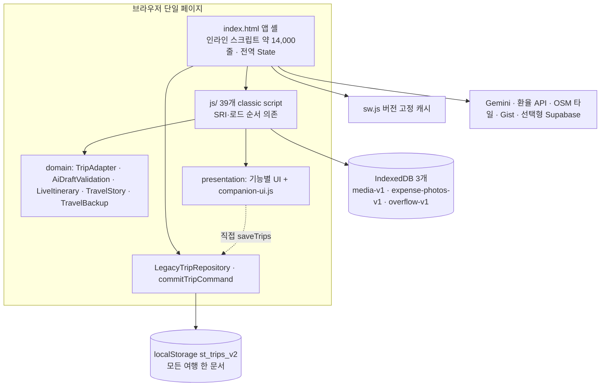

# 술술트래블 v2.0.1 기능·구조 분석과 목적 기반 개선 계획

검토일: 2026-11-21 · 기준: `main` = `origin/main` = `9486e13` · 앱 버전 표기 v2.0.1.

> **v2.0.2 후속**: 0단계(회귀 복구) 수정 범위와 검증 결과는 [§10](#10-0단계-진행-결과-v202)에 따로 적었다. 1~5단계는 진행하지 않았다.

이 문서는 수정 전 검토다. 아래 결함은 현재 코드에서 재현했거나 코드로 확인한 것이며, 수정·배포를 완료했다는 뜻이 아니다. 이전 검토인 [v1.9.2 구조 검토](architecture-review-v1.9.2-2026-10-09.md)와 [v1.9.3 구조 보강](architecture-hardening-v1.9.3.md)의 방향은 유지하고, 그 뒤에 생긴 변화를 반영해 순서를 다시 정한다.

## 1. 판단

술술트래블의 목적은 **여행을 계획하고, 현장에서 고치고, 그 기록을 평생 잃지 않는 오프라인 우선 여행 다이어리**다. AI는 초안을 만들고 사용자가 승인한다. 가계부와 동행 연결은 이 흐름을 돕는다.

v1.9.3~v2.0.1에서 이 목적을 지키는 경계를 세웠다. 일정 변경은 `commitTripCommand`로 저장하고, AI 초안은 `AiDraftValidation`으로 검증하며, 백업 경로를 통일했고, 서비스워커는 공개 자산만 캐시한다. 그런데 2026-11-06~11-10의 세 커밋(`e72e47c`, `a34d967`, `9486e13`)이 `companion-ui.js`를 225줄에서 1,983줄로 키우면서 새 현장 기능 다섯 가지를 이 경계 밖에 붙였다. 이번 검토에서 재현한 결함 6건 중 5건이 그 커밋들에서 나왔다.

따라서 새 기능을 더하기 전에 다음 순서로 진행한다.

1. **회귀 복구**: 기록 손실, 잘못된 비상 정보, 배포 혼합 문제를 고친다.
2. **경계 강제**: 규칙을 문서로만 두지 않고 검사로 막는다.
3. **기록 모델 하나로 통일**: 지금 4종으로 갈라진 기록을 하나의 계약으로 묶는다.
4. **IndexedDB 원본 저장소 이전**: 평생 기록을 담을 수 있는 저장 구조로 옮긴다.
5. **화면 분리**: 거대 파일을 기능 단위로 나눈다.

## 2. 기능 지도

| 영역 | 사용자가 하는 일 | 주요 구현 | 상태 |
| --- | --- | --- | --- |
| 허브 | 내 여행 목록·검색·필터·정렬, D-day, 평생 통계, 노선도, 가상 예제 | `index.html` `renderHub`·`renderTripCards`·`renderLifetimeAnalytics` | 안정. 화면 코드가 앱 셸에 있음 |
| 계획 | 여행 생성(140+국가, 거점 배분), 초안 스튜디오, AI 일정 생성·RePlan(검토 후 승인), 큰 계획 블록, 시간표, 지도, 예약·도시 가이드, 준비물 | `index.html`, `replan.mjs`, `orchestration.mjs`, `ai-draft-validation.js`, `js/destinations/` | 검증 경계 있음 |
| 현장(오늘) | 다음 일정, 완료·건너뜀, 자유 편집(삽입·이동·보류·Undo), 변경·취소·대체·지연, 시간 재정렬 미리보기 | `live-itinerary*`, `schedule-change*`, `spot-realignment*` | 명령 경계 적용됨 |
| 현장 보조(신규) | 오늘 HUD, 택시 카드, SOS, 빠른 환율, 예산 페이스, 음성 캡슐, 스토리 매거진 | `companion-ui.js` (1,983줄) | **경계 밖. 결함 재현됨** |
| 기록·이야기 | 하루 회고, 일정 기록, 여러 순간, 퀵 캡슐, AI 다듬기, PDF·Markdown·텍스트 출력 | `activity-journal.js`, `moment-journal.js`, `travel-story*.js`, `companion-ui.js` | 기록 모델 4종으로 분산 |
| 가계부 | 다통화 지갑·환전·예산, 지출 사진, 영수증 OCR, 분석 | `index.html`, `expense-editor.js`, `expense-photo-repository.js` | 사진은 IDB 보관 |
| 데이터·공유 | JSON 백업·복원, Gist 백업, 사본 링크·파일, 동행 서버(기본 비활성), 사진 최적화 | `travel-backup*`, `trip-transfer*`, `collaboration*`, `photo-*` | 경계 통일됨 |
| 앱 셸 | PWA 설치, 오프라인 캐시, SRI 불일치 복구, 테마 3종, 뒤로가기 | `sw.js`, `index.html` 상단 `SulsulShell`, `mobile-navigation.js` | 동작함. 릴리스 규칙에 의존 |

## 3. 아키텍처 현황

| 지표 | 값 | 의미 |
| --- | --- | --- |
| `index.html` | 20,237줄 · 1.26MB, 인라인 스크립트는 6,225행부터 | 화면·상태·업무 규칙이 여전히 셸에 집중됨 |
| 셸의 함수 선언 / 인라인 이벤트 속성 | 396 / 505 | 전역 함수 이름이 사실상 공개 API다 |
| `!important` | 422 | 화면별 덮어쓰기가 누적됨 |
| `js/` | 39파일 · 8,311줄. `companion-ui.js` 하나가 24% | 분리한 계층 안에 두 번째 거대 파일이 생김 |
| 일정 저장 경로 | `saveTrips` 직접 호출 23곳 / `commitTripCommand` 9곳 | 명령 경계는 일부 기능에만 적용됨 |
| `companion-ui.js`의 `window.__*` 전역 상태 | 9개 | 화면 상태가 모듈 밖 전역에 흩어짐 |
| 테스트 | 단위·계약 25파일 225개, 브라우저 24파일 | 새 현장 기능 5종의 회귀 검사는 `tests/`에 없음 |

### 유지할 기반

- `TripAdapter`의 안정 ID와 구버전 보완, `AiDraftValidation`의 생성·승인 공통 계약.
- `LiveItinerary` 명령(삽입·이동·보류·Undo)과 revision 충돌 방어.
- `TravelStory`의 원문·승인문 분리와 출처 manifest. 모든 이야기 출력이 쓸 읽기 모델이다.
- `TravelBackup`의 미리보기 후 승인, 손상 원문 보존.
- 서비스워커의 공개 자산 allowlist와 `SulsulShell`의 SRI 불일치 복구.

## 4. 이번에 재현한 문제

재현 환경: 격리된 Chrome 헤드리스(Playwright), 390×844, 가상 예제 여행(2030-04-01~05, 타이베이)과 합성 데이터. 사용자 여행·API 키·운영 사이트는 쓰지 않았다. 재현 스크립트는 저장소 밖의 작업 폴더에 두었다.

| ID | 우선순위 | 문제 | 재현 결과와 근거 | 원인 |
| --- | --- | --- | --- | --- |
| F1 | P0 · 기록 | 퀵 캡슐이 항상 여행 첫날에 저장됨 | 3일차(2030-04-03) 정오에 저장하자 `dayIndex 0`, `date 2030-04-01`로 저장됨. 하루 AI 일기도 첫날 캡슐만 모음 | `State.activePlanDayIndex`는 읽기만 하고 값을 넣는 코드가 없음(`companion-ui.js:1548`·`1593`). 날짜 대신 배열 위치로 연결하는 방식은 v1.9.3이 회고에서 제거한 것과 같은 패턴이다 |
| F2 | P0 · 기록 | 사진 캡슐 저장 실패를 성공으로 알리고 입력을 지움 | 휴대폰 사진 1장 크기(base64 약 470만 자)로 저장 문서가 11KB에서 4.7MB로 커짐. 두 번째 사진은 저장 공간 부족 경고 직후 `보관되었습니다!`가 덮어쓰고 입력창을 비움. 새로고침하면 그 캡슐은 없음 | `readAsDataURL` 원본을 압축 없이 여행 JSON에 넣음. `PhotoCompression`·`MediaRepository`를 거치지 않고 `saveTrips()` 결과를 무시함(`companion-ui.js:1506–1577`) |
| F3 | P0 · 원칙 | AI 일기가 승인 없이 기록으로 저장되고 이야기 출력에서 본문이 빠짐 | 코드 확인: `generateDiaryFromCapsules`가 Gemini 응답을 바로 `activityRecords`에 저장함. 본문 필드는 `content`인데 `TravelStory.selectText`는 `originalText/sourceText/text`만 읽음 | 기존 AI 검토·승인 경로(`orchestration`, `AiDraftValidation`)와 기록 계약을 쓰지 않음(`companion-ui.js:1591–1660`). PDF 출력 결과는 브라우저로 확인하지 않음 |
| F4 | P0 · 안전 | SOS 비상 번호·공관이 국가와 맞지 않음 | 중국(윈난) 여행에 `주타이베이 한국대표부`와 구급 `119`를 표시함. 중국 본토의 구급 번호는 120이다. 칠레 여행에는 경찰 911·구급 116을 표시함. 칠레는 경찰 133·구급 131이다. 남미 4개국을 번호 하나로 묶음 | 제목·도시 문자열 정규식으로 국가를 추정하고, 검증 출처 없는 번호표를 화면 코드에 하드코딩함(`companion-ui.js:900–987`). 앱에 윈난 팩이 있으므로 실제로 쓰이는 경로다 |
| F5 | P1 · 배포 | 버전을 올리지 않고 자산 내용을 바꿔 설치 기기에 복구 화면이 뜸 | `abb395c`(v2.0.1) 설치 상태에서 `9486e13`을 다시 열자 `companion.css`·`companion-ui.js`가 SRI 불일치로 차단되고 `앱 업데이트를 준비하고 있어요` 화면이 뜸. 온라인에서 버튼을 누르면 복구됨. 코드상 오프라인에서는 진행하지 않음 | `9486e13`이 자산 내용과 HTML의 SRI만 바꾸고 `?v=2.0.1`·`st-shell-v2.0.1`·`APP_VER`를 유지함. `sw.js`가 그대로여서 새 워커가 설치되지 않음 |
| F6 | P1 · 검증 | 브라우저 회귀 4종 실패 | HEAD에서 실행한 10종 중 6종 통과, 4종 실패. `companion-refresh`: 320~430px에서 대표 행동 버튼이 하단 메뉴 위에 있지 않음. `live-itinerary`·`schedule-change`: `e72e47c`가 카드에 추가한 `일정 관리 더보기` summary 때문에 선택자가 두 요소에 걸림. `travel-story`: 인쇄 화면에 이야기 외 요소가 남음 | UI를 바꾼 커밋이 기존 회귀 테스트를 실행·갱신하지 않음. 새 기능 검사는 `file://`로 여는 `tools/test-priority*.ps1`뿐이다 |

함께 확인한 구조 문제:

- **같은 기능이 두 벌씩 있다.** 빠른 환율 계산기는 지갑판 계산기(`initQuickCurrencyCalc`)와 모달(`openQuickCurrencyCalc`)로 두 개다. 이야기 출력은 `TravelStory` 기반 PDF와 캡슐·원본 여행을 직접 읽는 스토리 매거진으로 두 개다. 현지어 문구는 생존 스페인어 모달과 SOS 문구로 두 개다.
- **국가 지식이 세 곳에 있다.** 목적지 팩(`js/destinations/`), 셸의 140개국 정보(`resolveCountryInfo`), SOS 하드코딩 표다.
- **기록이 네 갈래다.** `journals`(하루 회고), `activityRecords`(일정 기록), `momentEntries`(순간), `quickCapsules`(퀵 캡슐). `quickCapsules`는 백업 요약, 공유 제외 목록, `TravelStory`가 모두 모른다.

## 5. 구조적 원인

1. **경계가 강제되지 않는다.** `commitTripCommand`가 있어도 `getActiveTrip()`을 직접 고치고 `saveTrips()`를 부르는 쉬운 길이 막혀 있지 않다. 새 기능은 대개 이 길을 택한다.
2. **기록 모델에 기준이 없다.** 기록 종류마다 날짜 연결, 사진 저장, 필드 이름이 다르다. 그래서 새 기능이 다섯 번째 형식을 만들기 쉽다.
3. **릴리스 규칙이 내용 변경을 검사하지 않는다.** `tools-verify.ps1`은 버전 문자열이 서로 일치하는지만 본다. 내용이 바뀌었는데 버전이 그대로인 경우는 잡지 못한다. 릴리스 태그도 없어 비교 기준이 없다.
4. **작업 절차가 도구마다 다르다.** 최근 세 커밋은 영문 메시지를 쓰고, 버전·변경 기록·실록·`tests/`를 갱신하지 않았다. `docs/development-model.md`의 절차가 적용되지 않았다. 워크스페이스 `CLAUDE.md`도 이 저장소 위치를 `00.Projects/여행준비/`로 적고 `Sulsul-Travel/`은 비었다고 적어 실제와 다르다.
5. **안전 정보에 출처가 없다.** 비상 번호·공관 연락처에 출처와 확인일이 없고 검사도 없다.

## 6. 목적에서 나온 개선 원칙

| 원칙 | 판단 기준 |
| --- | --- |
| 기록 무손실이 기능 수보다 우선 | 모든 쓰기는 하나의 명령 경계를 지난다. 실패는 실패로 표시하고 입력을 유지한다 |
| 현장 우선 | 오늘 화면의 핵심 동작은 한 손·오프라인으로 끝난다. 안전 정보는 정확하거나 비워 둔다 |
| AI는 초안 | 생성 → 검토 → 승인 → 원문 보존. 기록하지 않은 경험을 만들지 않는다 |
| 하나의 모델, 하나의 출처 | 기록 계약 하나, 국가 지식 하나, 이야기 읽기 모델 하나 |

## 7. 실행 계획

| 단계 | 작업 | 완료 판단 |
| --- | --- | --- |
| **0 · 회귀 복구** (다음 릴리스 v2.0.2) | ① 버전을 v2.0.2로 올려 정상 업데이트 경로를 복구한다. ② 캡슐: 오늘 날짜는 `resolveTodayDayIndex`나 사용자가 고른 날짜로 정하고 `dayId`·`date`를 저장한다. 저장은 `commitTripCommand`로 하고, 실패하면 입력을 유지하며 성공 안내를 띄우지 않는다. 사진은 `PhotoCompression`과 `MediaRepository`를 거친다. ③ AI 일기: 자동 저장을 없애고 검토창에서 승인할 때만 기존 기록 계약(`text`·`originalText`·`aiDraftAcceptedAt`)으로 저장한다. ④ SOS: 국가 판별을 오늘 거점의 국가 코드로 바꾸고, 번호는 국가별 데이터로 옮겨 출처·확인일을 단다. 확신이 없는 국가는 번호 대신 영사콜센터와 `현지 확인 필요`를 보여 준다. ⑤ 실패한 회귀 4종을 정리한다. 버튼 가림·인쇄 노출은 기능을 고치고, 선택자 충돌은 테스트를 의미 기반 선택자로 바꾼다 | F1~F6 재현 스크립트가 반대 결과로 통과한다. 브라우저 회귀 24종이 모두 통과한다. `test:sw-upgrade`에 '같은 버전, 다른 내용' 시나리오를 추가한다 |
| **1 · 경계 강제** | 정적 규칙을 추가한다. presentation 파일에서 `saveTrips(`·`TripRepository.saveAll`·`st_trips_v2` 직접 쓰기를 금지(허용 목록 관리)하고, 새 `window.__` 상태와 escape 없는 `innerHTML` 데이터 삽입을 금지한다. 직전 릴리스 태그와 비교해 바뀐 자산의 `?v=`가 그대로이면 실패하게 한다(릴리스마다 `v2.0.x` 태그 생성). 셸의 `saveTrips` 23곳을 기능별로 명령 경계로 옮긴다(지출 → 준비물 → 여행 설정 → 허브 순) | 규칙 위반을 넣은 fixture가 실패하는 회귀 검사를 둔다. 경계 밖 저장이 허용 목록에만 남는다 |
| **2 · 기록 모델 통일** | 공통 Record 계약: `id, kind(reflection·activity·moment·capsule), tripId, dayId, occurredDate, occurredAt?, spotId?, text, originalText, approvedText?, mood?, mediaIds[], source`. 읽기 어댑터부터 만든다. `TravelStory`가 네 종류를 모두 읽게 하고, 스토리 매거진은 그 모델을 그리는 보기로 바꾼다. 퀵 캡슐은 순간 기록의 입력 방식(음성·빠른 메모)으로 흡수하고 별도 컬렉션은 마이그레이션 후 폐지한다 | 일정 삽입·삭제·RePlan 뒤에도 모든 기록의 실제 날짜·원문·사진이 PDF·매거진·백업에서 일치한다 |
| **3 · IndexedDB 원본 저장소** | v1.9.2 검토의 D단계를 그대로 따른다. trips·days·items·records·expenses·media store로 나누고, 원문 백업 → 변환 미리보기 → 트랜잭션 → 개수·참조·사진 대조 → 채택 순서로 옮긴다. JSON의 data URL 사본은 백업할 때만 모은다. `navigator.storage.persist()` 요청, 저장 용량 표시, 마지막 백업 경과 알림을 추가한다 | 사진이 들어간 장기 여행 합성 자료로 백업 왕복, 중단·용량 초과 복구, 구버전 재접속을 검사한다 |
| **4 · 화면 분리** | 셸의 인라인 스크립트를 탭별 controller(허브·계획·오늘·기록·가계부·준비물·설정)로 나누고, `companion-ui.js`는 오늘 HUD·SOS·캡슐·매거진·택시·환율로 나눈다. 인라인 `onclick` 505개는 `data-action` 위임으로 옮긴다. 빌드 없이 브라우저 기본 ES 모듈(`type="module"`)을 쓸 수 있다. 디자인 토큰을 컴포넌트에 적용해 `!important`를 줄인다 | 기능 하나를 옮길 때마다 해당 브라우저 회귀가 통과한다. 화면을 한 번에 다시 쓰지 않는다 |
| **5 · 기능 정리와 확장** | 중복을 통합한다: 환율 계산기 1개, 현지어 카드 1개(목적지 팩 기반), 이야기 출력 모델 1개. 쓰임이 적은 기능(GPS 시뮬레이터, 일러스트 노선도 등)은 사용 데이터를 본 뒤 실험 메뉴로 옮길지 정한다. 동행 서버는 실제 두 계정·두 기기 RLS 검증 뒤 활성화한다 | 같은 일을 하는 화면이 하나만 남는다. 서버 기능은 실제 다중 계정 검증 결과로 판단한다 |

0단계가 끝나기 전에는 새 현장 기능을 추가하지 않는다. 1단계 규칙이 들어가야 2~4단계의 이전 작업 중에 경계 밖 저장이 다시 생기지 않는다.

## 8. 작업 절차 개선

- 이 저장소를 여러 AI 도구가 함께 수정한다. 작업 전 `DEVELOPMENT.md`와 `술술트래블신록.md`를 읽고, 커밋 전에 단위·브라우저 회귀와 버전 규칙을 통과해야 한다는 내용을 워크스페이스 `CLAUDE.md`·`AGENTS.md`의 술술트래블 절에 적는다. 저장소 위치 기술도 바로잡는다.
- 브라우저 회귀 실행법을 문서화한다. 이 기기에는 Playwright 브라우저가 설치되어 있지 않다. 번들 Node의 `playwright` 모듈을 `PLAYWRIGHT_MODULE`로, 설치된 Chrome을 `CHROME_PATH`로 지정하면 실행된다. `tools-verify.ps1`은 Edge 경로를 찾는다.
- 새 기능은 `tests/*.browser.cjs`에 HTTP 기반 회귀를 함께 추가한다. `file://` 검사는 서비스워커와 저장소 동작을 대표하지 못한다.

## 9. 검증 범위와 한계

- 실행한 검사: 단위·계약 225개 통과. 브라우저 회귀 10종(`companion-refresh`, `header-hub`, `live-itinerary`, `schedule-change`, `reliability`, `structural-reliability`, `service-worker`, `backup-restore`, `moment-journal`, `travel-story`) 중 6종 통과, 4종 실패. F1·F2·F4·F5 재현 스크립트 실행.
- 실행하지 않은 검사: 나머지 브라우저 회귀 14종, `tools-verify.ps1`, 실제 휴대폰과 iOS Safari, 실제 Gemini 호출, 운영 사이트, 오프라인 상태의 복구 화면 동작.
- 실패 4종이 어느 커밋부터인지는 확정하지 않았다. 직전 커밋 스냅샷으로 비교하려 했지만 그 환경에서는 모듈 로드부터 실패해 근거로 쓰지 않았다. 선택자 충돌을 일으킨 마크업은 `e72e47c`에서 추가됐다.
- 비상 번호의 정답(중국 구급 120, 칠레 경찰 133·구급 131)은 일반적으로 알려진 값이다. 데이터로 옮길 때는 외교부 해외안전여행 국가별 정보 등 공식 출처로 다시 확인하고 확인일을 기록한다.

## 10. 0단계 진행 결과 (v2.0.2)

2026-11-21. §7의 0단계를 v2.0.2로 수정했다. 1~5단계(경계 강제 규칙, 기록 모델 통일, IndexedDB 이전, 화면 분리, 중복 정리)는 진행하지 않았다.

| ID | 수정 | 검증 |
| --- | --- | --- |
| F1 | 퀵 캡슐을 순간 기록(`momentEntries`, `source:'capsule'`)으로 저장한다. 기본 날짜는 현지 오늘이고 다른 날을 고를 수 있다. 다른 날이면 기록 시각을 비운다. 기존 `quickCapsules`는 `TripAdapter`가 실제 생성 시각의 날짜로 옮긴다 | 3일차 저장 → `2030-04-03 12:00`. 첫날로 저장됐던 기존 캡슐 → 3일차와 연결 일정으로 복구 |
| F2 | 저장은 `commitTripCommand`, 사진은 `mediaRepository.prepare`(압축·IndexedDB)를 거친다. 실패하면 입력·사진을 남기고 성공 안내를 띄우지 않는다 | 11.8MB 원본 → 1280×960 보관본·320×240 썸네일, 문서 증가 65KB. 강제 용량 실패 시 입력 유지·재시도 성공 |
| F3 | AI 캡슐 일기는 `capsule-diary` 작업으로 검토창을 거쳐 승인할 때만 새 순간 기록으로 저장한다. 캡슐 메모를 `originalText`로 보관하고, 메모에 없는 내용을 지어내지 말라고 요청한다. 기존 자동 저장 글은 `AI 작성·검토 전`으로 표시해 옮긴다 | 승인 전 기록 수 불변, 승인 후 이야기 모델의 승인문으로 출력 |
| F4 | 긴급 번호를 `js/destinations/emergency-contacts.js`(35개국, 위키백과 긴급전화 목록 2026-10-16 판 대조)로 옮겼다. 국가는 오늘 거점 도시로 정하고, 여행 국가와 어긋나거나 정할 수 없으면 추정하지 않는다. 확인하지 못한 국가는 영사콜센터만 보여 준다. 대사관 직통 번호는 출처를 확인하지 못해 뺐다 | 윈난(CN) 경찰 110·구급 120, 칠레 133·131, 남미 다국가 일정은 그날 도시 기준, 미정이면 국가 선택 버튼 |
| F5 | 버전을 v2.0.2로 올려 새 서비스워커 캐시를 만든다(자산 쿼리·`sw.js`·`APP_VER`·`package.json`·변경 기록·실록) | `tools-verify.ps1` 전체 게이트 통과 |
| F6 | 오늘 화면에서 다음 일정 카드를 빠른 액션 덱·HUD보다 위로 올렸다. 인쇄 CSS는 열린 매거진만 인쇄한다. 회귀 테스트의 선택자는 카드 안 `더보기` 메뉴와 충돌하지 않게 직계 `summary`로 좁히고, 메뉴를 연 뒤 버튼을 누르게 했다 | `companion-refresh`·`travel-story`·`live-itinerary`·`schedule-change` 통과 |

함께 고친 것: 스토리 매거진은 `TravelStory` 모델을 그려 기록 본문이 빈칸으로 보이던 문제와 외화를 원화로 합산하던 문제를 없앴다. SOS 프랑스어 문구(`J'ai …`)의 복사 버튼 오류를 고쳤다. SOS 화면 상태는 `window.__sos*` 대신 `State.sos`에 둔다.

검증 결과(Chrome 헤드리스, `PLAYWRIGHT_MODULE`·`CHROME_PATH` 지정):

- 단위·계약 229개 통과(새 `tests/field-records.test.mjs` 4개 포함). `tools-verify.ps1` 전체 통과.
- 브라우저 회귀 25종 중 23종 통과(새 `tests/field-records.browser.cjs` 9개 검사 포함).
- 실패 2종은 수정 전 커밋 `9486e13`에서도 같은 검사가 실패하므로 이번 변경의 결과가 아니다. 다음 과제로 남긴다.
  - `demo-onboarding`: 공유 링크를 거절한 뒤 `snapshot-open-app`으로 돌아갈 때 주소의 `#share=`가 10초 안에 지워지지 않는다(2건).
  - `structural-reliability`: 오래된 두 번째 탭의 `saveTrips()`가 충돌로 거절되지 않고 `true`를 반환한다(1건). v1.9.3의 탭 간 덮어쓰기 방어가 다시 깨졌을 수 있는 기록 손실 위험이다. 세션 초반 같은 커밋 실행에서는 통과했으므로 시간·순서에 따라 달라지는지도 확인해야 한다.
- 확인하지 못한 것: 실제 휴대폰과 iOS Safari, 실제 Gemini 호출, 음성 인식, 운영 배포. 비상 번호는 위키백과 목록과 대조했으며, 외교부 해외안전여행 국가별 안내로 다시 확인하는 것이 좋다.

## 11. 남은 실패 2종 추적 결과 (v2.0.3)

- `structural-reliability`는 기록 손실 결함이 아니었다. 실패 회차에서는 첫 탭의 `saveJournalText`가 호출되지 않았다. 헤드리스 Chrome에서 화면 밖 저장 버튼에 `tap()`하면 스크롤 직후의 터치가 스크롤 0 기준으로 처리돼 제목(H4)을 눌렀다. 탭이 하나일 때도 부하가 있으면 12회 중 3회 재현됐다. 첫 탭 저장 방식만 바꿔 측정한 결과 `tap()` 10/12·스크롤 후 대기 9/12·`click()` 12/12·직접 호출 12/12 저장됐다. 저장이 기록된 43회 모두 두 번째 탭의 오래된 저장은 `STORAGE_CONFLICT`로 거절됐다. 검사는 `click()`으로 누르고 첫 저장이 기록됐는지 먼저 확인한다. 병렬 4회 실행 모두 통과했다.
- `demo-onboarding`은 실제 앱 결함이었다. 뒤로가기 가드가 `#share=` 주소의 기본 기록 위에 가드를 쌓은 상태에서, 주소 정리는 맨 위 가드만 바꿨다. 첫 터치의 가드 교체와 뒤로가기가 기본 기록으로 돌아가 가드를 다시 쌓으면서 공유 주소를 되살렸다. `MobileNavigation.replaceUrl`로 고쳤고 주소를 지우는 네 곳이 이 경로를 쓴다. 검사에 뒤로가기 뒤 주소 유지 확인을 더했다.
- 함께 확인한 것: 커밋 안의 `index.html` SRI는 Windows 작업 폴더의 CRLF 바이트로 계산돼 저장소의 LF 바이트와 일부 어긋난다(`646d1cb`에서 6개, 이전 커밋은 `leaflet.css` 1개). Vercel은 `tools/build-public.cjs`가 배포 바이트로 SRI를 다시 계산하므로 운영에는 영향이 없다. 새로 체크아웃한 폴더를 그대로 열 때만 복구 화면이 뜬다.

## 12. 1단계 진행 결과 (v2.0.4)

- **셸 저장 이전**: 기능 함수 15곳의 `saveTrips()`를 `commitTrip`(현재 revision으로 여행 하나 수정)·`commitTripCommand`(편집 시작 revision)·`commitTripsCommand`(여행 추가·복제)로 옮겼다. 변경은 저장소가 만든 복사본에 적용되고, 저장에 성공해야 `State`가 바뀐다. 실패하면 창과 입력을 남기고 성공 안내를 띄우지 않는다. 환전 삭제는 확인 창을 연 시점의 revision을 쓰고 ID로 지운다. 부르는 곳이 없던 `executeScheduleTuningLegacy`(revision 이중 증가)는 지웠다.
- **남은 직접 저장**: `tools/boundary-allowlist.json`에 27건이 사유와 함께 있다. 저장 경계 함수 자체 2건, 부팅 정규화·구버전 이관·읽기 전용 원문 대조, 그리고 이미 복사본에 쓰고 실패하면 되돌리는 전용 경로(하루 회고·일정 기록·순간 기록·지출·백업 복원·공유 사본·원격 계획·사진 최적화)다. 기록 경로는 2단계에서 공통 기록 명령으로 옮긴다. `renderCompanionPlan`의 렌더 중 구조 보정 저장은 4단계에서 부팅 정규화로 옮긴다.
- **정적 규칙**: `tools/lint-boundaries.cjs` — WRITE01(셸·presentation의 새 직접 저장), GLOBAL01(새 `window.__`), HTML01(escape 없는 HTML 삽입 수가 파일별 기준값을 넘지 않음). HTML01의 기준값 562곳은 정적 판별(문자열·숫자·`escapeHtml`·`*Html` 값 제외)로 센 수이며 모두 위험하다는 뜻도, 모두 안전하다는 뜻도 아니다. 줄이면 기준값도 낮춘다.
- **릴리스 규칙**: `tools/check-release.cjs` — 마지막 `vX.Y.Z` 태그 이후 배포 파일(index.html·sw.js·프리캐시 목록)의 내용이 바뀌었으면 `APP_VER`·서비스워커 캐시 버전·바뀐 자산의 `?v=`가 모두 올라가야 한다. 개행 차이는 무시한다. `abb395c`(v2.0.1)→`9486e13`에 실행해 서비스워커 버전과 자산 2개의 `?v=` 미상승 3건을 찾았다. 태그 `v2.0.2`·`v2.0.3`을 만들었다(원격에 올리려면 `--follow-tags`).
- **회귀 검사**: 규칙마다 위반을 넣은 fixture 검사(`tests/boundary-lint.test.mjs` 6개, `tests/release-check.test.mjs` 4개, 0단계에서 요구한 '같은 버전, 다른 내용' 포함). `structural-reliability`에 옮긴 명령의 실패 무변경·거짓 성공 없음, 끼어든 변경 뒤 환전 삭제 거절 검사 2개를 더했다. 두 검사는 수정 전 커밋(`dbb9c10`)에서 실패한다.
- **하지 않은 것**: 편집 창 기반 기능(초기 자금·환전 추가·큰 계획)은 아직 창을 연 시점이 아니라 저장 시점의 revision을 쓴다. 저장소 충돌(다른 탭)은 막지만, 같은 탭의 다른 화면이 그 사이에 바꾼 내용은 덮을 수 있다. HTML01 기준값을 줄이는 작업은 4단계 화면 분리 때 한다.

## 13. 2단계 진행 결과 (v2.0.5)

- **공통 기록 모델**: `js/domain/travel-records.js`(`TravelRecords`)가 하루 회고·일정 기록·순간 기록(퀵 캡슐 포함)을 한 형식으로 읽는다. 계획 7절의 Record 계약에 맞춰 `kind`·`id`·`tripId`·`dayId`·`occurredDate`·`occurredAt`·`time`·`spotId`·`text`·`originalText`·`approvedText`·`mood`·`mediaIds`·`source`와 판별 결과(`archiveDate`·`orphaned`·`hasContent`)를 낸다. 퀵 캡슐은 0단계에서 이미 순간 기록(`source:'capsule'`)으로 흡수했으므로 별도 `kind`를 두지 않았다.
- **읽는 곳 통일**: 여행 이야기(PDF·매거진·Markdown)는 날짜·일정 판별을 이 모델에 맡기고 출력은 그대로다(기존 TravelStory 테스트 통과). 허브 누적 통계·상세 목록, 작업 화면 통계(첫 렌더와 기록 저장 뒤 갱신 두 곳), 대표 사진 자동 선택, 공유 사본 확인, 전체 백업 요약이 모두 `summary`·`firstPhoto`를 쓴다. 글·사진·기분·날씨가 모두 빈 항목은 기록이 아니다.
- **찾아서 고친 어긋남**: 허브 상세 목록이 하루 회고만 내부 키(`Day archive:…`)로 보임, 공유 확인 창이 순간 기록을 셈하지 않음, 기록 저장 뒤 작업 화면 통계가 빈 회고까지 셈(새 브라우저 검사가 찾음), 대표 사진이 하루 회고만 봄, 시각 미상 순간 기록 하나로 기록 포함 공유 전체가 실패함.
- **쓰는 곳 통일**: 하루 회고 글·사진, 일정 기록 저장·삭제, 순간 기록 저장·삭제를 `commitTripRecord`(저장소 `commit`, 기록 단위 충돌 검사 유지)로 옮겼다. 경계 검사 허용 목록 27건 → 21건.
- **완료 기준 검사**: `tests/travel-records.test.mjs`가 일정 삽입·이동·삭제·재계획·큰 계획 날짜 변경 뒤에도 모든 기록의 발생 날짜·원문·승인문·사진 수가 같고, 이야기·백업 요약이 같은 수를 내며, 다른 날로 옮긴 일정의 기록이 남긴 날짜에 출력되는지 본다. `tests/records-consistency.browser.cjs`가 실제 화면에서 허브·상세 목록·작업 화면·공유 확인·기록 저장을 본다.
- **하지 않은 것**: 기록을 저장소에서 한 컬렉션으로 합치는 저장 구조 변경은 3단계(IndexedDB) 몫이다. 지금은 세 필드(`journals`·`activityRecords`·`momentEntries`)를 그대로 두고 읽기·쓰기 경로만 하나로 모았다. 매거진은 0단계에서 이미 TravelStory를 그린다.

## 14. 3단계 진행 결과 (v2.0.6) — 사진 분리(3a)

- **측정**: 이 브라우저의 localStorage 한도는 약 524만 자, IndexedDB 한도는 약 10GB였다. 압축을 거친 질감 많은 사진 한 장이 원본·썸네일 합쳐 약 32만 자를 여행 문서에 차지해, 기존 구조로는 기록 사진 15~25장에서 저장이 실패했다.
- **기록 사진 분리**: `js/infrastructure/storage/record-media-store.js`가 지출 사진과 같은 원칙으로 하루 회고·일정 기록·순간 기록 사진을 문서에서 뺀다. 계획의 순서(원문 백업 → 변환 → 트랜잭션 → 대조 → 채택)를 다음처럼 지킨다. 처음 옮기기 전 원래 문서를 `sulsul-travel-migration-v1`에 한 번 보관한다 → 보관본이 없는 사진은 IDB에 쓰고 다시 읽는다 → 되살린 문자열이 문서 사진과 같을 때만 → 다음 저장에서 `photos[i]=''`로 뺀다. 원문 보관이 실패하면 아무 사진도 빼지 않는다. 이중 쓰기를 최종 상태로 남기지 않는다(대조된 사진은 IDB에만 있다).
- **시점**: 새 사진은 `MediaRepository.prepare`의 보관 거래가 끝나는 순간 대조 목록에 들어가 그 기록의 첫 저장부터 빠진다. 옛 사진은 부팅 때(화면 전) 보관·대조하고 `initApp`의 정규화 저장에서 빠진다. 복원은 쓰기 전에 사진을 보관소로 옮긴다. 저장 뒤 백그라운드 쓰기는 거짓 충돌을 만들어 없앴다(실록 111호).
- **저장 공간·백업 상태**: 설정 → 데이터에 문서 사용량, 기록 사진의 보관 상태(보관소·문서 안·찾지 못함), 사진 보관소 사용량, 영구 보관 여부와 요청, 마지막 백업 시각을 보인다. 백업 14일 경과 또는 문서 80% 사용 시 하루 한 번 알린다.
- **완료 기준 검사**: `tests/record-media.browser.cjs` — 사진 22장(1,374만 자) 장기 여행의 문서가 7,101자이고 새로고침 뒤 같은 사진(부팅 약 0.9초), 13MB 백업을 빈 기기에 복원해도 문서 7,920자, IDB를 지우면 22장을 찾지 못했다고 알리고 문서·참조를 바꾸지 않으며 불완전한 백업을 거절, 옛 문서는 원래 문서를 보관한 뒤 옮김, 실제 v2.0.5 앱이 이전된 문서를 열어 저장해도 참조를 지우지 않고 새 버전에서 모두 다시 보임.
- **남은 3단계(3b)**: 여행·일정·기록·지출을 IDB의 여러 store로 나누는 일. 지금 저장 API(`TripRepository`)가 동기이고 거의 모든 화면이 저장 결과를 바로 쓰므로, 명령 경계를 비동기로 바꾸는 작업이 먼저다. 그 전까지 문서에는 글·일정·지출만 남아 한도에 여유가 있다. 앱을 열 때 모든 기록 사진을 메모리에 읽으므로 사진이 수백 장을 넘으면 필요할 때 읽는 방식(화면 분리와 함께)이 필요하다. 사진이 많은 공유 사본 파일 가져오기는 아직 보관소를 거치지 않는다.

## 15. 3단계 진행 결과 (v2.0.7) — 비동기 저장 경계(3b 1차)

- **왜 먼저 했나**: 여행 자료를 IndexedDB로 옮기려면 저장이 비동기가 된다. 지금 화면은 저장 결과를 바로 쓰므로(`State.trips = saveAll(...)`), 백엔드만 바꾸면 저장 전에 성공 안내가 뜨고 실패해도 입력이 사라진다. 그래서 3b를 둘로 나눠, 이번에는 저장 백엔드(localStorage)는 그대로 두고 명령 경계만 비동기로 바꿨다. 기존 브라우저 회귀가 그대로 판정 기준이 된다.
- **TripStore**: `js/infrastructure/storage/trip-store.js`. 저장을 한 줄로 차례대로 실행하고, 각 저장은 시작하는 순간의 목록을 기준으로 삼아 성공한 작업 안에서 `State.trips`를 바꾼다. 여행 목록 전체 저장은 저장 직전 목록을 받는 함수로 만들고, 호출 때 만든 배열은 그 사이 여행 ID·revision 지문이 바뀌었으면 거절한다. 셸의 `TripRepository` 이름은 그대로 두었다(이제 `TripStore`).
- **전환 범위**: 셸과 화면 파일의 저장 지점 약 60곳에 `await`를 붙였다. 삭제 확인 창은 확인 동작을 기다리고 그동안 다시 눌리지 않는다. 예제 추가 연타는 예제 하나만 만든다. AI 일기의 보조 보관 경로도 저장 줄 안에서 실행한다.
- **ASYNC01**: 저장 명령과 그것을 (간접적으로) 부르는 함수는 `await`·`return`으로 기다려야 하고, 비동기 결과를 조건·대입에 쓰면 실패한다. 전환 중 빠뜨린 두 곳을 찾았다. 렌더 중 구조 보정 저장 한 곳만 사유와 함께 허용 목록에 있다.
- **검증**: 단위 257개(새 `trip-store.test.mjs` 8개 — 느린 비동기 백엔드에서 연달아 맡긴 저장이 모두 남는지 포함), 브라우저 회귀 27종, `tools-verify.ps1` 통과. 저장 실패를 일부러 만드는 브라우저 검사 세 곳은 결과를 저장보다 먼저 읽어, 실패 경로를 검사하지 않은 채 통과하고 있었다. 저장을 기다리게 고쳤다(실록 112호).
- **남은 3b(2차)**: 여행 자료를 IndexedDB로 옮기는 일. 백엔드를 `TripStore` 아래에서 바꾸고, 원문 보관 → 이전 → 다시 읽어 대조 → 채택 순서로 옮긴다. 옛 문서는 다른 창의 구버전이 덮어쓰지 못하게 표시만 바꿔 남긴다. 다른 창 충돌 판정은 문서 원문 비교 대신 저장소의 버전 번호로 한다. 브라우저 검사의 `localStorage` 직접 읽기를 저장소 읽기로 바꾸는 작업이 함께 필요하다.

## 18. 4단계 진행 결과 (v2.1.0) — 화면 분리 2차: 기록 탭

- **옮긴 것**: `index.html` [6] 구역(약 180줄)과 하루 회고 사진 삭제를 `js/presentation/journal-tab.js`(`SulsulTravel.JournalTab`)로 옮겼다. 인라인 처리기 15곳을 `journal.*` 동작 14개로 바꿨다(UI01 658 → 643곳, HTML01 `index.html` 451 → 444곳, 새 파일 0곳).
- **부르는 쪽**: 셸(키보드 날짜 이동·큰 계획 카드·AI 윤문 전 저장), `activity-journal.js`·`moment-journal.js`(저장 뒤 다시 그리기), `companion-ui.js`(오늘 화면의 '하루 회고 작성')가 새 API를 부른다.
- **검증에서 고친 것**: 전역 함수를 바꿔 끼워 화면 오류를 재현하던 `record-persistence` 검사가 새 경로에서도 실제로 고장을 일으키는지 확인하고, 주입 횟수를 검사에 넣었다(실록 115호).
- **다음**: 가계부(지출·환전·예산·통화 선택). 가장 큰 화면이라 둘 이상의 릴리스로 나눈다.

## 17. 4단계 진행 결과 (v2.0.9) — 화면 분리 1차: 동작 위임과 준비물 화면

- **4단계 진행 방식**: 7절대로 화면 하나씩 옮기고 그때마다 그 화면의 브라우저 회귀를 통과시킨다. 옮기는 화면 파일은 `js/presentation/<화면>.js`의 classic script(IIFE)로 두고 셸 함수와 `State`는 부를 때 읽는다. 모든 화면이 옮겨지기 전까지 셸의 전역 함수와 인라인 스크립트가 함께 살아 있어야 하므로, 브라우저 기본 ES 모듈(`type="module"`, 늦게 실행되고 전역을 나누지 않음)로의 전환은 마지막에 판단한다.
- **동작 위임**: `js/presentation/ui-actions.js`. 버튼은 `data-on-click`·`data-on-change`·`data-on-input`에 `이름공간.동작`을 적고, 화면 파일이 `UiActions.define`으로 등록한다. 등록되지 않은 이름은 오류로 드러난다. 이름은 처음에 `data-action`으로 정했으나 오늘 화면이 이미 같은 속성을 CSS 순서 표식으로 쓰고 있어 나눴다(새 브라우저 검사가 발견).
- **준비물 화면**: `js/presentation/checklist-tab.js`로 옮기며 먹통 버튼 세 개를 고쳤다. 보기 전환(v1.8.4부터 없는 함수), 예약 가이드의 준비물 체크(v1.1.7부터 없는 함수, 체크가 저장되지 않음), 예약 가이드의 '준비물 추가'(v1.1.7부터 없는 창). 준비물을 추가할 방법이 없었으므로 추가 창과 상세 창의 안전 삭제를 만들었다.
- **검사 규칙**: UI01(파일별 인라인 처리기 수, 시작값 658곳 — `index.html` 498, `companion-ui.js` 83 …), UI02(없는 함수·등록되지 않은 `data-on-*` 이름·없는 창). UI02를 v2.0.8 코드에 돌려 세 버튼(4군데)을 모두 찾는 것을 확인했다.
- **검증**: 새 `checklist-tab` 8개 검사(실제 클릭), 경계 검사 단위 5건 추가, 기존 단위·브라우저 회귀와 `tools-verify.ps1`.
- **다음 화면 순서(제안)**: 기록 탭(하루 회고·순간 기록 목록, 인라인 처리기 13곳) → 가계부(지출·환전·예산·통화 선택, 약 2,500줄) → 계획(타임라인·지도·예약 가이드·도시 가이드) → 허브·통계 → 설정·공유·설치 안내 → `companion-ui.js`(오늘 HUD·SOS·캡슐·매거진·택시·환율)와 렌더 중 구조 보정 저장의 부팅 정규화 이동 → 디자인 토큰과 `!important` 정리. 화면마다 그 화면의 인라인 처리기를 0으로 만들고 UI01 기준값을 낮춘다.

## 16. 3단계 진행 결과 (v2.0.8) — 여행 자료 IndexedDB 이전(3b 2차)

- **저장 구조**: `js/infrastructure/storage/idb-trip-repository.js`. DB `sulsul-travel-trips-v1`에 여행 하나를 레코드 하나(`{slot, json}`)로 두고, `meta.doc`에 순서와 버전을 둔다. json은 옛 문서 안 여행 하나와 같은 직렬화 문자열이다. 그래서 이전 대조·백업·사진 준비가 지금까지와 같은 원문을 쓴다. 저장할 때는 바뀐 여행만 쓰고, 다른 창 충돌은 같은 거래 안에서 읽은 버전으로 가른다.
- **계획과 다르게 한 것**: 7절의 계획은 trips·days·items·records·expenses로 나누는 것이었다. 이번에는 여행 단위로만 나눴다. 문서 한도 해소, 바뀐 것만 쓰기, 거래 단위 원자성은 여행 단위로 충분하다. 일정·기록을 다시 나누면 읽을 때마다 조립해야 하고, 참조 일관성을 새로 지켜야 한다. 기록을 필요할 때 읽어야 할 만큼 커지면(화면 분리와 함께) 기록 저장소를 따로 나눈다.
- **이전**: 원문 보관(`before-trip-store`) → 한 거래 복사(다른 창이 먼저 옮겼으면 하지 않음) → 다시 읽어 대조 → 옛 문서 표시(줄바꿈) → 채택 표시(`st_trip_store_v1`). 손상 문서는 옮기지 않고 지금까지처럼 복구 모드로 시작한다.
- **구버전과 함께 사는 법**: 업데이트 중 열린 구버전 창은 원문 충돌로 저장을 거절당한다. 되돌린 구버전은 옮길 때의 자료로 열리고, 그 변경은 새 버전이 따로 보관한다. 옛 문서는 30일 뒤 지운다. 채택한 뒤 IndexedDB가 열리지 않으면 저장을 거절한다.
- **검증**: 새 `trip-store-idb` 8개 검사(실제 v2.0.7 앱 포함). 기존 브라우저 회귀 28종, 단위 258개, `tools-verify.ps1` 통과. 기존 검사는 저장 결과를 `readRaw()`로 확인하도록 바꿨다. 저장 실패 주입은 검사용 다리(`tests/helpers/playwright.cjs`)로 IndexedDB 저장에도 적용했다.
- **남은 것**: 실제 휴대폰·iOS Safari 확인. 사진 많은 공유 사본 가져오기의 사진 보관소 경유. 앱을 열 때 모든 기록 사진을 읽는 문제(4단계 화면 분리와 함께 필요할 때 읽기). 3단계는 이것으로 마친다.
